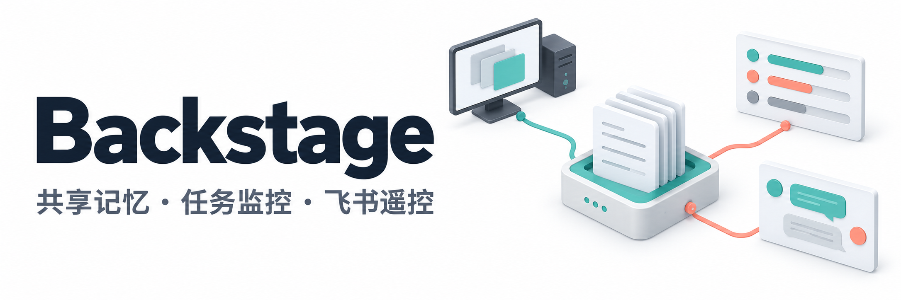

<p align="center">
  
</p>

# Backstage

为 Codex、Claude Code 和 Kimi 提供跨仓库记忆、只读工作台、任务监控与飞书遥控。

- **共享记忆**：记录事实、决策与来源，用稳定 task ID 串联跨仓库工作。
- **多机协作**：按需通过私有 S3 同步知识、Skill 和记忆，也可只在本地使用。
- **只读工作台**：浏览项目、记忆、时间线、文档与本机运行状态。
- **监控与遥控**：飞书任务交互，Pi / susser-tod 训练和 B1K 评测监控；其他业务可接适配器。

## 当前版本

最新版本：**v0.8.0** · 当前功能版本：**v0.8.0**。

**v0.8.0 主要功能**

- 无需 S3 的本地初始化，接好 Prompt / Skill 后直接用自然语言开展工作；支持预演并保留已有配置。
- 按事件回顾同任务前后记录与修正链，先看小索引，再按需批量读取完整依据。
- 运行页展示记忆健康明细、Skill 最低核心版本，以及服务启动版本与本机源码差异。
- 修复飞书队列取消、跨聊天打断、训练采集失败误报与时间分片问题；优化长修正链扫描。

保留相关性检索、任务交接、质量评测、深浅主题与只读工作台。升级与兼容说明见 [版本记录](docs/changelog.md)。

## 快速开始

完整工具环境支持 Linux x86-64，需要 Git 和 [Pixi](https://pixi.sh/)。

```bash
git clone https://github.com/ZenosZeng/backstage.git ~/code/.agents
cd ~/code/.agents
pixi install --locked
```

全新工作区可先预演，再完成本地接入（机器名请保持唯一）：

```bash
python3 scripts/sync.py --dry-run init --local --machine-id my-dev-machine
python3 scripts/sync.py init --local --machine-id my-dev-machine
```

默认使用仓库父目录作为工作区，为 Codex、Claude Code、Kimi 建立 Skill 链接和工作区入口。已有独立入口会保留并报告冲突，需先按 [最小工作区示例](examples/README.md) 整理。仅运行记忆脚本需要 Python 3.10+，无需 S3、飞书或 Agent CLI。初始化不会自动启动服务；已有 S3 工作区沿用原配置，不运行本地初始化。

## 日常使用

接好工作区入口 Prompt（`AGENTS.md` / `CLAUDE.md`）和记忆 Skill 后，在 Codex、Claude Code 或 Kimi 中直接描述任务即可。

Agent 会在实质性任务开始时读取相关记忆，在确认可复用的事实、决策和验证结论后主动记录；启用并初始化 S3 后，也会按 Skill 完成同步。日常无需手动执行记忆读写、同步命令，也无需每次提醒 Agent“记一下”。重要结论仍需由 Agent 核对源码、Git 和测试。

| 场景 | 可以这样说 |
| --- | --- |
| 继续工作 | “继续昨天的接口重构，先看看上次做到哪，还有哪些未解决的问题。” |
| 查询历史决策 | “上次为什么选这套方案？找出当时的决策和验证依据。” |
| 查看前因后果 | “围绕这条记忆看看之前和之后发生了什么，有没有后续修正，再核对完整证据。” |
| 跨仓库协作 | “这个功能涉及 API 和前端两个仓库，用同一个任务跟踪进展。” |
| 交接任务 | “整理这个任务的交接摘要，包括进展、关键决策、验证结果和下一步。” |
| 暂停与恢复 | “把这个任务标记为暂停。” / “恢复这个任务，先回顾当前状态。” |
| 检查运行状态 | “检查 Backstage 的本机配置、记忆和已配置服务的状态，先报告发现的问题。” |

### 飞书常用指令

飞书遥控配置并启动后，可以直接发送上面的自然语言任务：私聊直接发，群聊需 @机器人。

| 指令 | 作用 |
| --- | --- |
| `/help` | 查看全部指令和打断词 |
| `/status` | 查看当前 Agent、工作目录、上下文、队列和累计统计 |
| `/claude` / `/dsh` | 切换当前聊天的 Agent，两边分别保留上下文；DSH 需本机可用 |
| `/new [claude\|dsh\|all]` | 清空指定 Agent 上下文（默认当前）及本聊天待执行队列；保留目录和累计统计 |
| `/cd <目录>` | 切换当前聊天的工作目录，例如 `/cd ~/code/my-project` |
| `/queue <指令>` | 排队执行，当前任务结束后自动开始，上限 5 条 |
| `/cost` | 查看当前 Agent 累计轮次、输出 token 和耗时；Claude 另报费用 |
| `/restart` | 校验并重载桥接服务，保留会话；任务与队列空闲时可用 |

执行中可直接发送“停”“停止”“打断”“取消”“stop”或“cancel”打断当前任务；追加任务用 `/queue`，按开始执行时选中的 Agent 运行。命令与会话按聊天隔离，完整说明见 [工具参考](tools/README.md#飞书里的用法)。

## 部署、维护与排障

以下是首次启用服务、维护或排障时的底层命令，也可以让 Agent 按参考文档执行相应操作。

| 用途 | 命令 |
| --- | --- |
| 本机配置与记忆自检 | `pixi run memory doctor` |
| 查看已配置服务状态 | `pixi run tools-status` |
| 启动只读工作台 | `pixi run web` |

工作台默认地址为 `http://127.0.0.1:8787`，只读、不提供网页遥控；远程工作区需转发端口。

监控与飞书遥控须先从 `tools/config/` 复制模板到 `.local/config/` 并填写配置，再按需启动：

| 工具 | 命令 |
| --- | --- |
| Pi 训练监控 | `pixi run watchdog-train` |
| B1K 评测监控 | `pixi run watchdog-b1k` |
| Claude 飞书遥控 | `pixi run claude-feishu` |

配置、启停及飞书指令见 [工具参考](tools/README.md)；S3 初始化与同步见 [记忆参考](docs/memory.md)。这些能力独立配置，不要求全部启用。

## 常用配置

记忆配置使用 `config.json`，服务配置使用 `.local/config/`；工作区知识与记忆位于 `.share/`。这些目录和本机配置不进入 Git，存储与飞书凭据保存在本机私有文件中。

遥控须设置用户白名单；工具权限不是操作系统沙箱。完整约束与配置说明见 [工具参考](tools/README.md) 和 [记忆参考](docs/memory.md)。

## 开发

```bash
pixi install -e dev --locked
pixi run -e dev test
pixi run -e dev lint
```

测试使用临时目录、合成日志和 mock，不需要真实 S3 或 GPU。不要提交私人记忆、完整聊天、配置或凭据。

固定记忆质量样例使用 `pixi run memory-eval` 运行，基线对比方法见 [记忆参考](docs/memory.md#固定质量评测)。

`main` 为生产分支，改动通过独立分支和 PR 合入，提交采用中文 Conventional Commits；版本与协作规则见 [开发规范](docs/development.md)。

## 文档

[记忆与同步](docs/memory.md) · [工具参考](tools/README.md) · [工作台](tools/web/README.md) · [版本记录](docs/changelog.md)

## 许可

[MIT License](LICENSE)。依赖项遵循各自的许可证。
